# 📦 Olist 이커머스 데이터 기반 AI 프로젝트

브라질 마켓플레이스 Olist의 실제 주문 데이터(2016~2018)로 **상품 · 리뷰 · 판매자** 문제를 머신러닝/딥러닝으로 풀고,
저장한 모델 4개를 불러와 예측하는 **Streamlit 대시보드**로 서빙한 포트폴리오 프로젝트입니다.

<br>배포 사이트: https://olist-ai-project.streamlit.app/
<br>PDF 다운로드: [olist_ai_project_slides.pdf](https://github.com/user-attachments/files/34413458/olist_ai_project_slides.pdf)


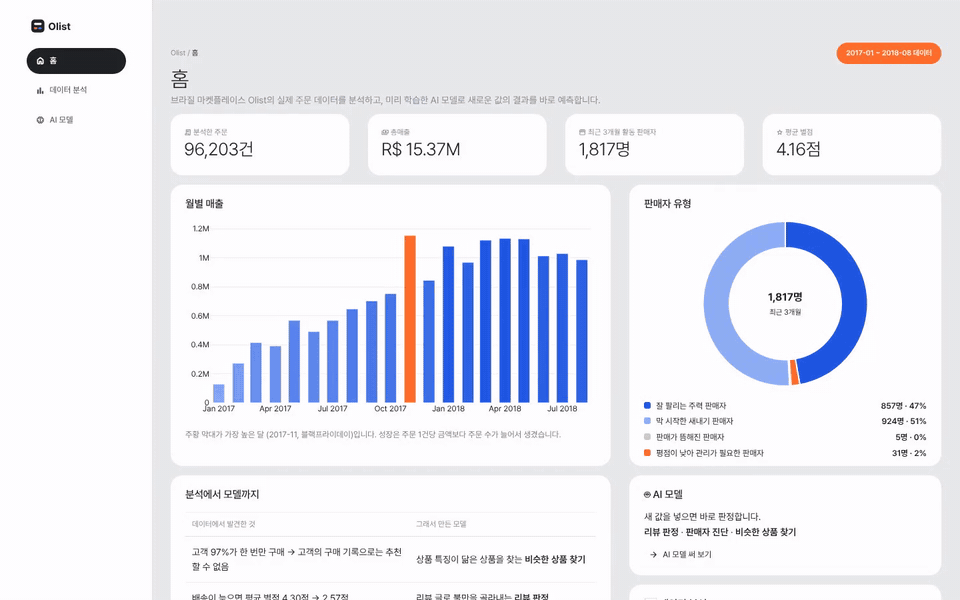

> 🎬 데모 영상 (MP4, 약 1분) : [docs/demo/olist_dashboard_demo.mp4](docs/demo/olist_dashboard_demo.mp4)

## 프로젝트 개요

Olist는 브라질의 중소 판매자와 고객을 연결하는 이커머스 마켓플레이스입니다.
Kaggle 공개 데이터(CSV 9개)를 하나로 합쳐 탐색(EDA)하고, 데이터에서 확인한 사실로 **풀 수 있는 문제를 다시 정의**한 뒤
네 가지 모델을 학습·비교했습니다. 마지막으로 학습 없이 저장된 모델만 불러와 예측하는 대시보드를 만들었습니다.

| 단계 | 내용 |
| --- | --- |
| 데이터 | CSV 9개 병합 → **119,143행 × 40열** 통합 데이터 (고유 주문 99,441 · 고객 96,096 · 상품 32,951) |
| EDA | 분석 기간 2017-01-05 ~ 2018-08-29 배송 완료 주문, **인사이트 10가지** → 모델링 문제 정의 |
| AI 모델 | 유사 상품 추천 · 리뷰 감성 분석 · 판매자 유형 군집 · 판매자 이탈 예측 (4종) |
| 서빙 | `.pkl` 4개(합계 약 340KB)를 불러와 예측하는 **Streamlit 3페이지 대시보드** (로컬 실행) |

### 왜 ‘고객’이 아니라 ‘상품’과 ‘판매자’인가

| 데이터에서 확인한 것 | 그래서 |
| --- | --- |
| 고객의 **97.0%** 가 한 번만 구매, 고객 × 상품 표에서 채워진 칸 **0.003%** | 협업 필터링(비슷한 고객이 산 상품)은 배울 데이터가 없음 → **상품 특징 기반** 추천 |
| 고객 이탈은 “전부 이탈”만 찍어도 정확도 97% | 매달 반복 판매하는 **판매자의 판매 중단**을 예측 |
| 배송이 늦으면 평균 리뷰 **4.30 → 2.57** | **리뷰 글**로 불만을 자동 분류, 지연이 몰린 **판매자 유형** 찾기 |

## 사용 기술

- **언어/분석** : Python, pandas, NumPy
- **머신러닝** : scikit-learn (KNN, Logistic Regression, Random Forest, K-Means, PCA, TF-IDF)
- **딥러닝/NLP** : TensorFlow/Keras (Embedding, Bi-LSTM), Hugging Face BERT (pipeline)
- **시각화** : Matplotlib (분석), Plotly (대시보드)
- **서빙** : Streamlit, joblib
- **환경** : Google Colab (분석 · 모델 학습)

## EDA — 인사이트 10가지

| # | 인사이트 | 핵심 숫자 |
| --- | --- | --- |
| 1 | 고객 대부분이 한 번 사고 떠난다 | 1회 구매 고객 97.0% |
| 2 | 고객은 남동부 3개 주에 몰려 있다 | SP · RJ · MG 주문 66.6% |
| 3 | 신용카드 할부가 구매의 기본이다 | 신용카드 75.5%, 그중 할부 66.8% |
| 4 | ‘보통 주문’은 평균보다 훨씬 작다 | 평균 R$160 vs 중앙값 R$105 |
| 5 | 성장은 객단가가 아니라 주문 수에서 왔다 | 주문 2.40배, 객단가 +1.4% |
| 6 | 블랙프라이데이 — 공정한 비교의 중요성 | 2017-11-24 하루 1,147건 (평소 7.8배) |
| 7 | 평일 낮에 사고, 새벽 · 주말에는 덜 산다 | 10시부터 16시까지 45.2%, 0시부터~5시까지 4.8% |
| 8 | 많이 팔리는 것과 돈이 되는 것은 다르다 | watches_gifts 개수 7위 → 매출 2위, 상위 17개 카테고리가 매출 80% |
| 9 | 배송이 늦으면 리뷰가 무너진다 | 평균 리뷰 4.30 → 2.57, 1점 비율 7배 |
| 10 | 성수기와 먼 지역에서 배송이 늦어진다 | 지연율 최고 21.4% (2018-03), SP 7.2일 vs 북부 24~26일 |

## 4가지 비즈니스 문제와 해결

### 1. 유사 상품 추천 — 같은 카테고리면 비슷한 상품일까? (PART 6)

상품 1개 = 1행인 특징표(가격 · 무게 · 크기 · 사진 수 · 평점)를 원본에서 직접 만들고, 거래 3건 이상 · 상위 15개 카테고리의 **2,498개** 상품으로 비교했습니다.
카테고리는 ‘종류’를 맞추는 필터, 숫자 특징은 ‘급’을 맞추는 거리(KNN)로 씁니다.

- 기준 상품과의 특징 차이(가격 · 무게 · 부피 평균) : 랜덤 **72%** → 가격 ±20% 조건 **45%** → **KNN 30%**
- 가격 조건만 붙이면 6%의 상품은 추천 후보 5개를 채우지 못함
- 평가 기준을 여러 개로 잡아야 공정 (가격만 보면 가격 조건이 1등)
- 한계 : 특징 유사도만 쟀을 뿐 고객 반응은 모름 → A/B 테스트 필요

### 2. 리뷰 감성 분석 — 별점 없이 글만 보고 불만을 알 수 있을까? (PART 7-1 · 7-2 · 7-3)

리뷰 37,139건(긍정 26,380 / 부정 10,759, 3점 제외)을 같은 test로 머신러닝 · 딥러닝 · 사전학습 모델을 비교했습니다.

| 모델 | 정확도 | 비고 |
| --- | --- | --- |
| 기준선 (전부 긍정) | 0.710 | |
| **TF-IDF + 로지스틱 회귀** | **0.917** | 부정 F1 0.869, 약 176KB → **배포** |
| TF-IDF + 로지스틱 회귀 (bigram) | 0.926 | 입력 개선 실험 |
| Embedding 평균 (Keras) | 0.924 | 약 2.5MB |
| Bi-LSTM | 0.919 | 단어 순서 반영 |
| BERT (학습 없이 사용, test 500건) | 0.730 | 같은 500건에서 로지스틱 0.918 |

- 누수 방지 : 단어집(TF-IDF · Tokenizer)은 train으로만 만들고 test는 변환만
- 부정 단어에서 **배송 지연 · 오배송 · 품질 · 파손**이라는 불만 유형이 드러남
- 리뷰가 짧고 핵심 단어로 판단되는 문제라 딥러닝과 머신러닝의 차이가 거의 없음 → 가볍고 정확한 모델을 배포

### 3. 판매자 유형 — Olist에는 어떤 판매자들이 있을까? (PART 8)

기준일(2018-05-31)까지의 유효 주문으로 판매자 **2,502명**의 프로필을 만들고 K-Means로 묶었습니다.

- 로그 변환을 하지 않으면 대형 판매자 22명이 군집 하나를 차지
- 엘보우로 후보를 좁히고 실루엣 점수로 **k = 4** 결정
- 핵심 우량 876 · 신규 성장 947 · 휴면 461 · **저평점 위험 218명**
- 저평점 위험 유형은 평균 배송 약 22일, 출고 지연율 약 33% → 판매자 출고 단계부터 늦음

### 4. 판매자 이탈 예측 — 앞으로 3개월 동안 판매를 멈출 판매자는? (PART 9)

기준일(2018-06-01) 이전 기록으로 특징을, 이후 3개월 주문 여부로 정답을 만들어 **시간으로 누수를 막았습니다**. (2018-03~05 활동 판매자 1,567명, 이탈 24.1% · ‘3개월 주문 없음’은 실습용 정의)

| 모델 (5-fold 교차검증) | 정밀도 | 재현율 | F1 | AUC |
| --- | --- | --- | --- | --- |
| 규칙 (최근 30일 판매 없음) | 0.49 | 0.58 | 0.53 | 0.77 |
| 로지스틱 회귀 | 0.59 | 0.32 | 0.40 | 0.79 |
| **로지스틱 회귀 + balanced** | 0.47 | **0.75** | **0.58** | 0.80 |
| 랜덤 포레스트 + balanced | 0.48 | 0.67 | 0.55 | 0.80 |

- `class_weight`로 재현율 약 0.3 → 0.75
- 로지스틱 회귀(balanced)는 5개 fold 모두 규칙보다 F1이 높았음 (랜덤 포레스트는 5번 중 2번)
- test(314명) : 재현율 0.75 · 정밀도 0.43 · F1 0.55 → 이탈 76명 중 57명을 미리 찾음
- 유형별 이탈률 : 핵심 우량 17% ~ 저평점 위험 66%

### 비즈니스 전략으로 연결 (PART 10)

| 문제 | 근거 (모델) | 실행 | KPI |
| --- | --- | --- | --- |
| 재구매 3%, 성장이 신규 유입에만 의존 | 유사 상품 추천 | 상품 페이지 · 장바구니에 “비슷한 상품” 노출 | 추천 클릭률, 주문당 상품 수, 객단가 |
| 배송 지연 → 리뷰 급락 | 감성 분류 | 부정 리뷰 자동 분류 → CS 우선 대응 | 부정 리뷰 응답 시간, 재리뷰 평점 |
| 지연 · 저평점이 일부 판매자에게 몰림 | 판매자 유형 | 유형별 관리 (출고 마감 관리 · 온보딩 · 우수 판매자 혜택) | 유형별 출고 지연율, 평균 평점 |
| 판매자 이탈 → 상품 구색 · 매출 감소 | 이탈 확률 | 이탈 확률 × 판매액으로 연락 우선순위 | 3개월 뒤 실제 이탈률, 유지된 판매액 |

최신 시점(2018-08-23)에 모델을 적용해 활동 판매자 1,817명 중 이탈 확률 0.5 이상 **637명**, 별점 4~5점인데 내용은 강한 불만인 리뷰 **23건**을 찾았습니다.

## 📊 서빙 대시보드 (STEP2)

| 페이지 | 보여 주는 것 |
| --- | --- |
| 홈 | 분석 주문 · 총매출 · 활동 판매자 · 평균 별점, 월별 매출, 판매자 유형 비율, 분석 → 모델 흐름 |
| 데이터 분석 | 지역 · 기간 필터, 핵심 지표 6개, 핵심 인사이트, 탭 6개 (매출 추이 · 주문 시간 · 카테고리 · 배송/별점 · 지역 · 데이터) |
| AI 모델 | 리뷰 판정(한국어 입력 시 포르투갈어로 옮겨 판정 + 판정 근거 단어), 판매자 진단(유형 · 이탈 가능성 · 위험 요인), 새 상품 정보로 비슷한 상품 찾기, 모델 설명 |

## 📑 포트폴리오 PPT

### 01. 표지
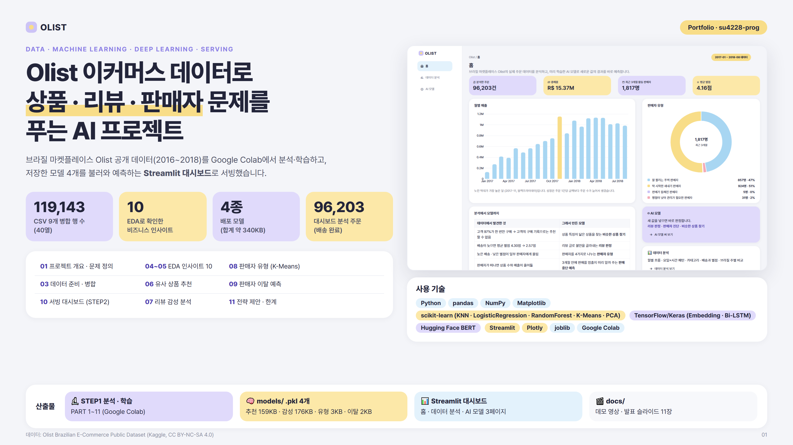

### 02. 프로젝트 흐름과 문제 정의
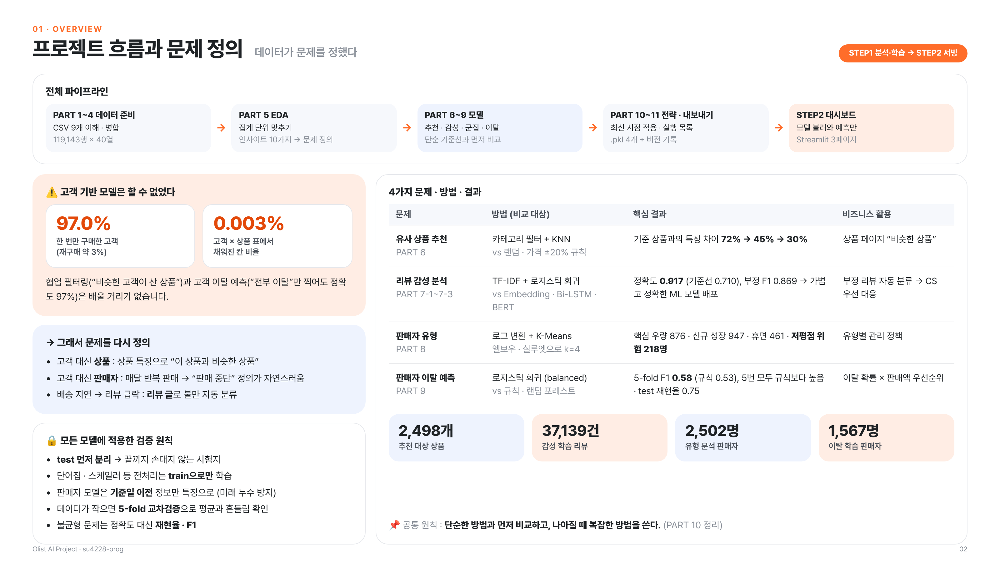

### 03. 데이터 준비 — 병합과 집계 단위
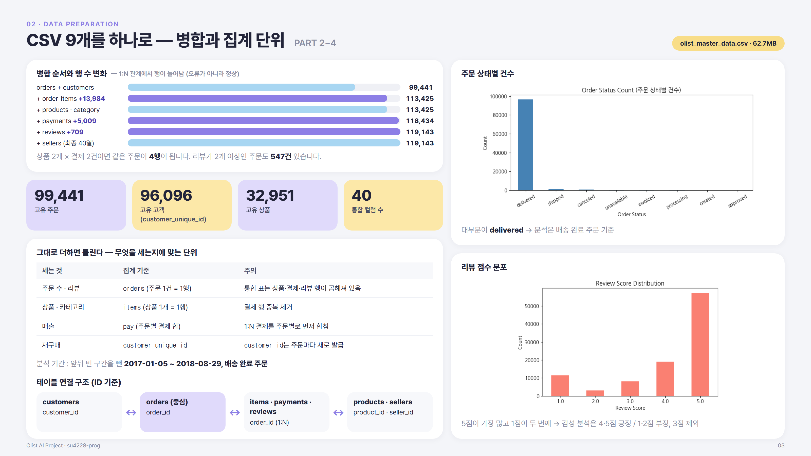

### 04. EDA ① — 누가, 얼마나, 언제 사는가
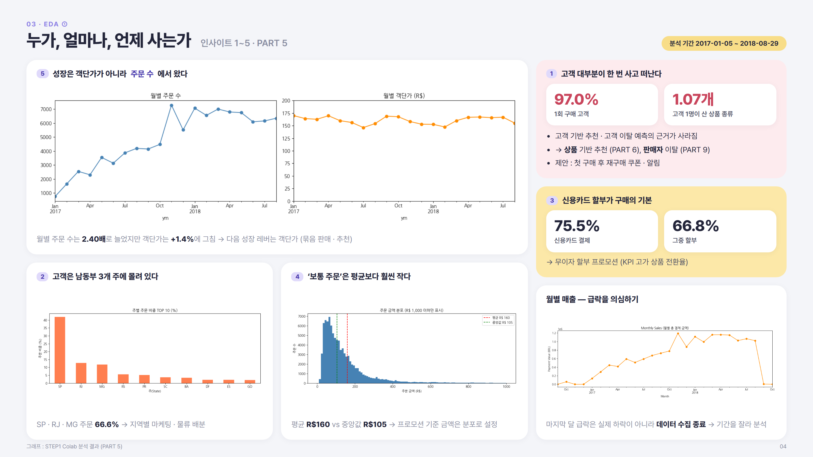

### 05. EDA ② — 무엇이 팔리고, 배송은 리뷰를 어떻게 바꾸나
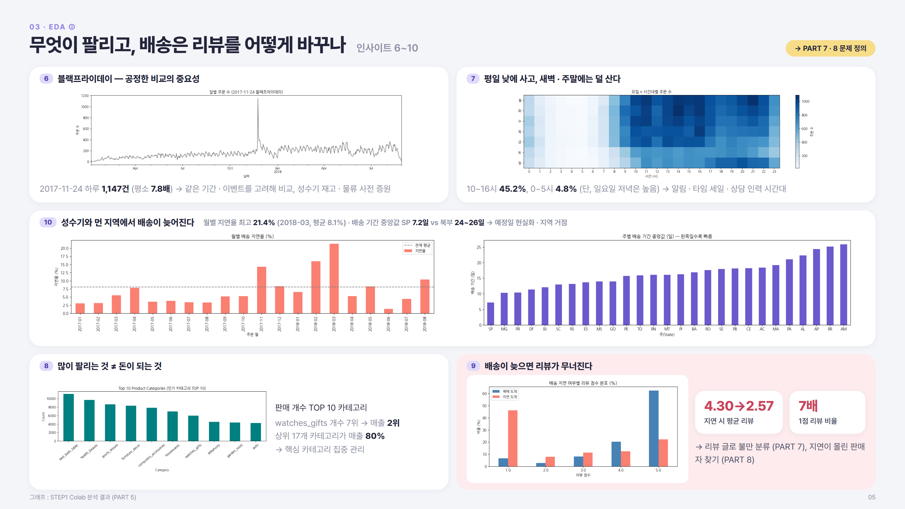

### 06. 유사 상품 추천
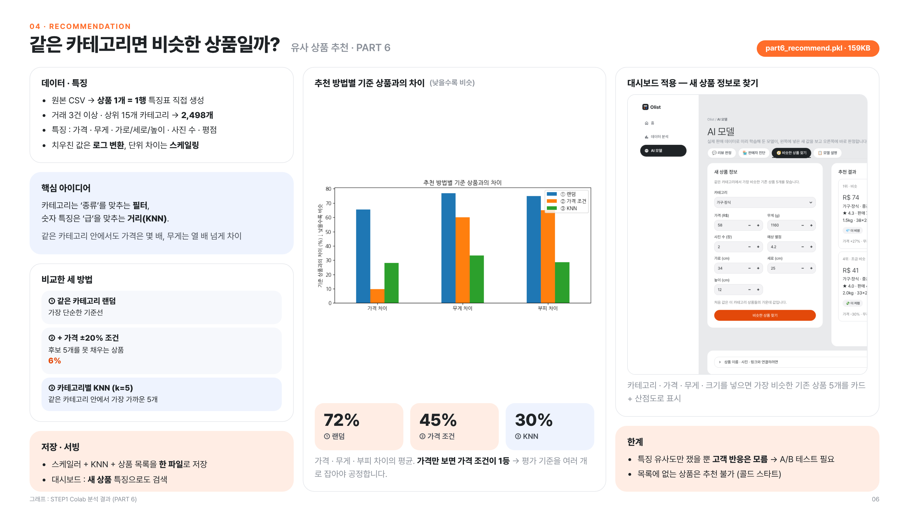

### 07. 리뷰 감성 분석
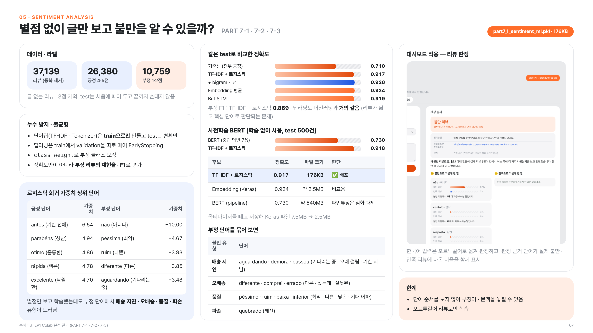

### 08. 판매자 유형 (K-Means)
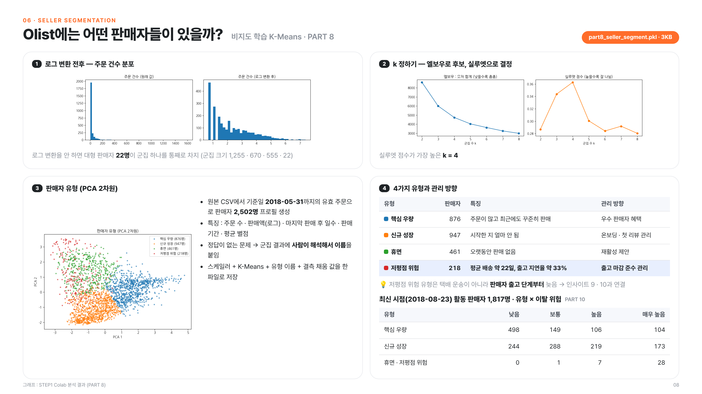

### 09. 판매자 이탈 예측
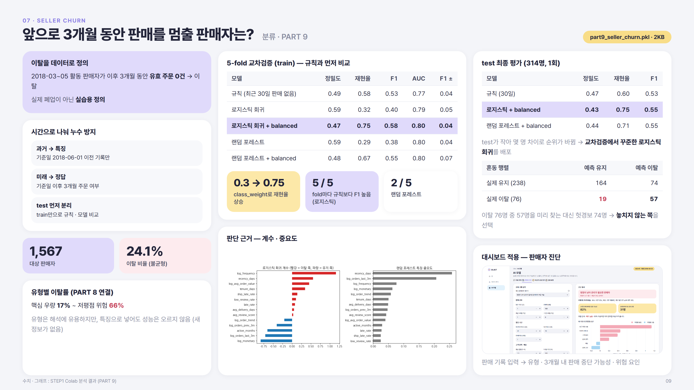

### 10. 서빙 대시보드
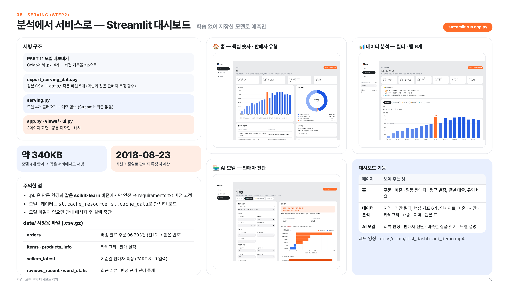

### 11. 전략 제안과 한계
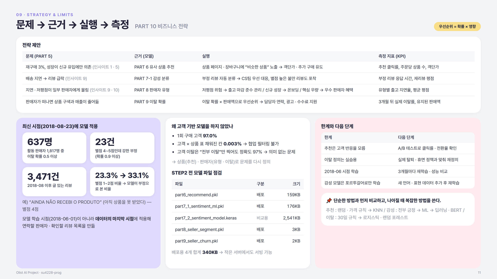


## 실행 방법

서빙용 데이터(`data/*.csv.gz`)와 학습된 모델(`models/*.pkl`)이 저장소에 포함되어 있어 바로 실행할 수 있습니다.

```bash
# 1) 저장소 클론
git clone https://github.com/su4228-prog/olist-ai-project.git
cd olist-ai-project

# 2) 라이브러리 설치 (.pkl을 만든 scikit-learn 버전으로 고정)
pip install -r requirements.txt

# 3) 대시보드 실행 → 브라우저에서 http://localhost:8501
streamlit run app.py
```

- 분석 · 모델 학습은 Google Colab에서 진행했고, 이 저장소에는 학습된 모델 파일과 서빙 코드가 들어 있습니다. 원본 CSV는 [Kaggle Olist 데이터셋](https://www.kaggle.com/datasets/olistbr/brazilian-ecommerce)에서 받을 수 있습니다.
- 서빙용 데이터를 다시 만들려면 : `python export_serving_data.py --raw <원본 CSV 폴더> --out .`
- 리뷰 판정 근거 단어 통계를 다시 만들려면 : `python make_word_stats.py --raw <원본 CSV 폴더>`

## 프로젝트 구조

```
olist-ai-project/
├── app.py                      # STEP2 대시보드 진입점 · 페이지 이동
├── views/                      # home.py · analysis.py · ai_models.py (페이지별 화면)
├── ui.py                       # 색상 · CSS · 그래프 테마 · 카드 등 화면 부품
├── common.py                   # 데이터 · 모델 불러오기 (캐시)
├── serving.py                  # 모델 4개 불러오기 + 예측 함수 (학습 없음)
├── export_serving_data.py      # 원본 CSV → data/ 서빙용 파일
├── make_word_stats.py          # 리뷰 판정 근거용 단어 통계
├── models/                     # part6 · part7_1 · part8 · part9 .pkl
├── data/                       # 서빙용 데이터 (.csv.gz)
├── assets/ · .streamlit/       # 로고 · 테마 설정
├── docs/
│   ├── demo/                   # 데모 영상 (mp4 · gif)
│   ├── slides/                 # 포트폴리오 슬라이드 PNG
│   └── slides_html/            # 슬라이드 원본 HTML
└── requirements.txt
```

## 이 프로젝트에서 확인한 것

- **데이터가 문제를 정한다** : 재구매 3%라는 숫자 때문에 고객 대신 상품 · 판매자로 문제를 다시 정의했습니다.
- **단순한 방법과 먼저 비교한다** : 랜덤 · 규칙 · 기준선보다 나을 때만 복잡한 모델을 택했고, 감성 분석은 딥러닝 · BERT 대신 가볍고 정확한 로지스틱 회귀를 배포했습니다.
- **누수를 막는 검증** : test 먼저 분리, 전처리는 train으로만, 판매자 모델은 기준일로 과거 · 미래를 나눴습니다.
- **분석에서 서비스까지** : 저장한 모델을 불러와 예측만 하는 대시보드로 결과를 직접 써 볼 수 있게 했습니다.

## 데이터 출처

[Olist Brazilian E-Commerce Public Dataset](https://www.kaggle.com/datasets/olistbr/brazilian-ecommerce) (Kaggle) · CC BY-NC-SA 4.0 · 비영리 교육용

---

개발 : [su4228-prog](https://github.com/su4228-prog)
